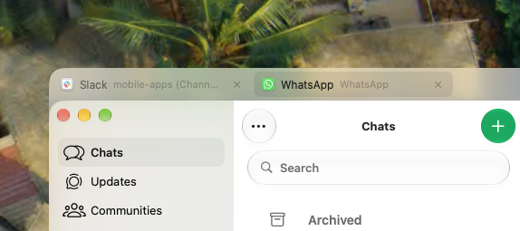

# Tab Groups

Tab Groups is a native macOS menu bar utility that turns windows from different apps into one tabbed container. Slack, WhatsApp and your browser can share one spot on screen, with a tab bar on top to switch between them.



## What it does

- **One bar per group.** A frosted glass bar spans the top of the group, with a tab for every window in it. Click a tab to bring that window forward.
- **Group by dragging.** Hold Shift, drag a window onto another one, and let go. The target gets a blue outline while you drag.
- **The group moves as one.** Drag the bar, drag any window in the group, or let a window manager such as Rectangle Pro reposition one. Everything in the group follows.
- **Pull a tab out.** Drag a tab away from the bar and its window leaves the group and follows the pointer.
- **Groups survive restarts.** On launch or wake, Tab Groups reconnects each group to the windows that are still open.

## Requirements

- macOS 14 or later. The glass bar uses Liquid Glass on macOS 26 and later, and a regular blur before that.
- Accessibility permission, which macOS requires for moving and resizing other apps' windows.

## Getting started

1. Open `TabGroups.xcodeproj` in Xcode and run the `TabGroups` scheme.
2. Tab Groups appears in the menu bar. Choose **Accessibility Permission…** and enable Tab Groups in System Settings.
3. Group two windows, either way:
   - Hold Shift and drag one window onto the other.
   - Choose **Create a Group…** from the menu bar, select the windows, and click **Group**.

## Using groups

| To do this | Do this |
| --- | --- |
| Group two windows | Hold Shift, drag one onto the other, release the mouse, then release Shift |
| Add a window to a group | Shift-drag it onto the group, or Shift-drag a grouped window onto it |
| Merge two groups | Shift-drag a window of one group onto the other group |
| Switch windows | Click a tab |
| Move the group | Drag the empty part of the bar, or move any window in the group |
| Resize the group | Resize the visible window |
| Remove a window | Drag its tab out of the bar, or click the tab's close button |
| Delete a group | Open **Show Groups** from the menu bar and click the trash icon |

A new group forms where the window you dropped onto sits. The window you dragged becomes the selected tab.

## Good to know

- **Hold Shift until after you release the mouse.** Letting go of both at the same instant can be read as cancelling the drop.
- **Shift-dragging only groups when a window actually moves.** Shift-dragging inside an app, such as extending a text selection, does nothing.
- **The last tab cannot be pulled out.** Dragging it moves the group instead.
- **Top of the screen.** The bar normally sits just above the group's windows. When a window is snapped against the top edge, the bar takes the top 36 points of that area and the window sits just below it.
- **Apps that limit their own size.** Some apps refuse the size a group asks for (Terminal snaps to its character grid, for example). Tab Groups keeps the group's size and lets that window differ slightly.
- **Restoring.** Tab Groups does not launch apps or reopen documents. If a saved window cannot be matched to exactly one open window, assign it by hand in the Groups window.
- **Where groups are stored.** `~/Library/Application Support/TabGroups/groups.json`.

## Development

Run the tests from Xcode, or from the command line:

```sh
xcodebuild -project TabGroups.xcodeproj -scheme TabGroups -destination 'platform=macOS' test
```

The tests cover the pure rules: group geometry, what a drop does, hit testing, persistence and window matching. Anything that touches real windows needs a hands-on check.

### Layout

| Folder | Contents |
| --- | --- |
| `TabGroups/Geometry` | Pure rules for the container, the bar and hit testing |
| `TabGroups/Interaction` | The coordinator: creating groups, movement, Shift-drag, live window handles |
| `TabGroups/TabStrip` | The bar's panels and views, and screen coordinate helpers |
| `TabGroups/WindowControl` | Accessibility wrappers and the window scan |
| `TabGroups/Persistence` | The saved groups file and its migrations |
| `docs/plans` | Design notes and implementation plans |

### Accessibility permission during development

Select a stable **Team** under the app target's **Signing & Capabilities** in Xcode. Without one, Xcode signs the app ad hoc, and macOS can treat each rebuild as a different app: the old Accessibility toggle stays visible while the new build is untrusted.

After switching signing identities, remove the old Tab Groups entry from **System Settings → Privacy & Security → Device Control and Data Access**, run the newly signed app, enable it, and relaunch it.
